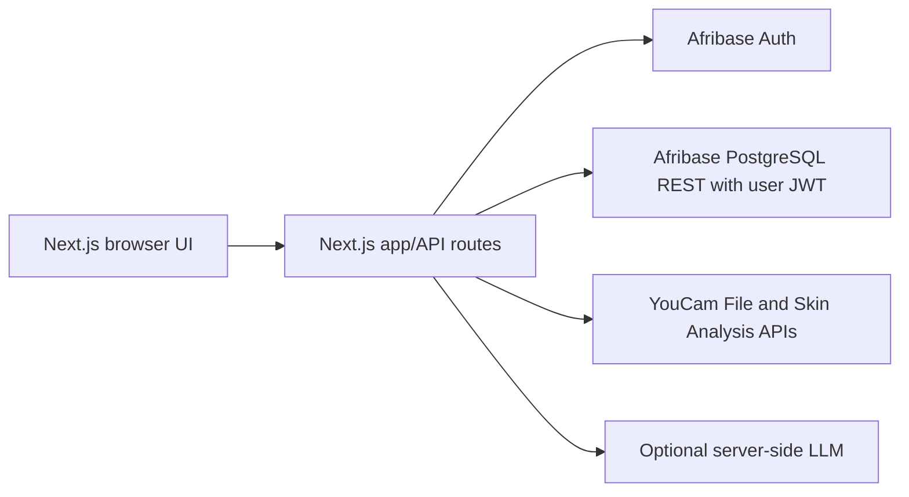

# Architecture and demo walkthrough

## Architecture

Browser requests reach Next.js route handlers. The handler reads the HttpOnly session cookie and makes Afribase REST requests with the user's JWT, preserving row-level security. After consent, the scan route uploads the selfie to YouCam through its File API, then saves the returned analysis in Afribase. The app does not save the selfie in Afribase Storage. YouCam handles the uploaded image under its own retention policy.

## Devpost submission draft

**DermaPilot AI: Understand Your Skin. Shop Smarter.** DermaPilot is a privacy-minded skincare intelligence and discovery experience that puts YouCam Skin Analysis into a consumer-friendly routine: consent, image analysis, plain-language results, practical catalog-backed products, budget-aware morning/evening steps, and progress history. It is designed for diverse skin tones and makes clear that results are cosmetic guidance, never a diagnosis. Sample product data is explicitly labeled and compatible products are selected by stated product attributes, not invented efficacy scores.

## 2-minute demo walkthrough

1. Introduce the problem: skincare shopping is noisy, and generic advice often ignores budget and context.
2. Create an account, set skin goals and a spending cap, and explain the image-processing consent.
3. Open New scan, upload a JPEG/PNG/WebP under 8 MB, preview it, confirm consent, and run analysis. Point out the provider label. With no API credentials, the UI reports development mock and deliberately shows no made-up scores.
4. Show the results and timeline, then open the product catalog. Filter by category, concern and budget, showing sample-data labels.
5. Generate a routine from catalog attributes and preferences, save it, and return to the dashboard.
6. Close with privacy: authenticated access, user-row policies, consent before sending the image to YouCam, and no medical claims.

## YouCam integration explanation

`lib/youcam.ts` isolates the provider adapter. Set `YOUCAM_API_KEY`; `YOUCAM_API_BASE_URL` is optional. The adapter creates a File API upload, uploads the image to the returned URL, creates a v2.0 skin-analysis task, polls for completion, and normalizes returned JSON scores. Provider payloads are preserved; no result payload is fabricated. A complete live scan still requires an enabled YouCam plan and a consenting signed-in user.

## Current test status

`npm test`, `npm run typecheck`, and `npm run build` pass. Unit tests cover budget filtering, catalog matching/ranking, and affordable routine construction. End-to-end account/YouCam integrations need real user credentials and YouCam API access to validate against their hosted services.
